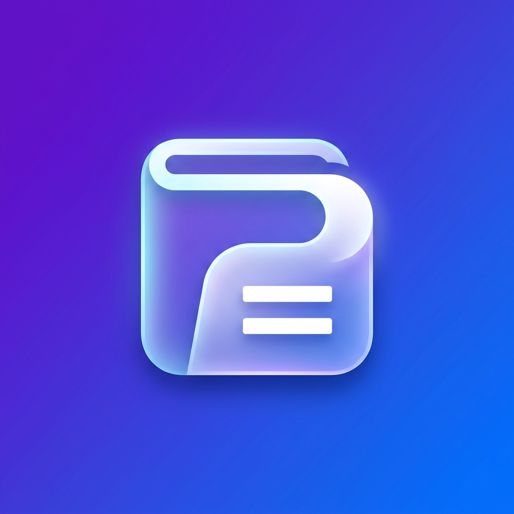

<p align="center">
  
</p>

<h1 align="center">Pay-Balace</h1>

<p align="center">
  <strong>Financial Management & Double-Entry Accounting App</strong><br/>
  100% Local-First · Offline-Ready · Personal Finance + Business Accounting · Liquid Glass UI
</p>

<p align="center">
  
  
  
  
  
</p>

---

## Ringkasan

**Pay-Balace** adalah aplikasi manajemen keuangan dan pembukuan akuntansi mobile (*Android, iOS-ready, dan Web preview*) yang menggabungkan kemudahan **Personal Finance** dengan ketelitian **Business Accounting berbasis Double-Entry Bookkeeping** (*Debit = Kredit*) dalam satu aplikasi tanpa ketergantungan pada server backend.

Dirancang dengan estetika **Liquid Glass Modern Colorful**, tipografi **Plus Jakarta Sans**, animasi halus, serta navigasi **Hybrid (Floating Liquid Glass Bottom Navigation + Sidebar Drawer)**.

---

## Fitur Utama

### 1. Multi-Workspace & Combined Dashboard
- **Personal Finance:** Pencatatan pemasukan, pengeluaran, transfer rekening, anggaran, dan utang/piutang secara cepat dan sederhana.
- **Business Finance (Double-Entry):** Pembukuan bisnis profesional dengan 20 akun **Chart of Accounts (COA) Standar UMKM** bawaan.
- **Combined Overview (Read-Only):** Ringkasan total kekayaan gabungan (*Personal + Business*) dengan konversi mata uang otomatis ke *Base Currency*.

### 2. Sistem Pembukuan Double-Entry Bisnis
- **Mode Transaksi Cepat (Auto-Journal):** Pilih kategori & rekening, sistem otomatis memposting pasangan Debit & Kredit secara atomik (ACID).
- **Mode Jurnal Manual (Debit/Kredit):** Input multi-baris dengan *Sticky Balance Bar* real-time ($\sum \text{Debit} = \sum \text{Kredit}$, minimal 2 baris).
- **Immutable Posted Journals:** Jurnal yang sudah `POSTED` terkunci dan tidak bisa diedit/dihapus sembarangan; koreksi dilakukan melalui **Jurnal Pembalik (Reversal Entry)**.
- **6 Laporan Akuntansi Bisnis:**
  1. Jurnal Umum (*General Journal*)
  2. Buku Besar (*General Ledger* dengan *Running Balance*)
  3. Neraca Saldo (*Trial Balance*)
  4. Laba Rugi (*Profit & Loss*)
  5. Neraca (*Balance Sheet*)
  6. Arus Kas (*Cash Flow Statement*)

### 3. Transfer Antar-Workspace Berpasangan
- Transfer **Personal ↔ Business** otomatis membentuk 2 transaksi yang saling terhubung (`paired_transaction_id`).
- Di sisi Business, dana dicatat pada akun Ekuitas (**Setoran Modal Pemilik / Prive**), **bukan** sebagai pendapatan atau biaya operasional bisnis.
- Mendukung kurs transfer lintas mata uang dan pembatalan konsisten pada kedua sisi.

### 4. Export Excel (`.xlsx` 7-Sheet), Backup & Upload Restore
- **Export Excel Profesional (`.xlsx`):** Menghasilkan 7 worksheet terformat rapi (*auto-fit column width*, format Rupiah `"Rp"#,##0`, *Auto-Filter*, dan baris `TOTAL`):
  1. `Ringkasan`
  2. `Transaksi`
  3. `Jurnal Umum`
  4. `Rekening`
  5. `Chart of Accounts`
  6. `Anggaran`
  7. `Utang Piutang`
- **Download & Upload Backup (`.qoubackup`):** Mendukung **Backup Normal** dan **Backup Terenkripsi (Password-Protected)** lengkap dengan fitur **Upload & Restore** langsung dari perangkat.

### 5. Fitur Pendukung & Keamanan
- **Multi-Currency & Riwayat Kurs:** Mendukung kurs manual dan sinkronisasi otomatis tersimpan lokal (*offline cache*).
- **Bukti Transaksi:** Lampirkan foto (kamera/galeri), PDF, dan dokumen lokal pada transaksi.
- **Trash & Recovery:** *Soft Delete* dengan pemulihan (*Restore*) serta proteksi *Permanent Delete* untuk menjaga integritas pembukuan.
- **Keamanan & Pengalaman Pengguna:** Onboarding wajib, layar kunci **PIN + Biometrik**, **Cinematic Launch Splash**, **Tutorial Interaktif 4 Langkah**, tema **Light & Dark Mode**, serta bahasa **Indonesia & Inggris**.
- **Expo Auto-Update (OTA):** Halaman khusus di **Pengaturan → Pembuatan, Versi & Auto-Update** terintegrasi dengan `expo-updates` untuk memeriksa dan menerapkan pembaruan OTA secara otomatis.

---

## Tech Stack

| Komponen | Teknologi |
| :--- | :--- |
| **Framework** | Expo (~52) + React Native (0.76) |
| **Language** | TypeScript (Strict Mode) |
| **Navigation** | Expo Router (Hybrid: Floating Glass Tabs + Drawer) |
| **Database** | Expo SQLite (17 Tabel ACID, WAL Mode, Foreign Keys) |
| **State & Form** | Zustand, React Hook Form, Zod |
| **UI & Typography** | React Native StyleSheet, `expo-blur`, `expo-linear-gradient`, **Plus Jakarta Sans** |
| **Charts & Icons** | React Native SVG, Lucide React Native |
| **Excel & Backup** | SheetJS (`xlsx`), `expo-file-system`, `expo-sharing`, `expo-document-picker` |
| **Security & OTA** | `expo-local-authentication`, `expo-crypto`, `expo-updates` |
| **Build System** | EAS Build & EAS Update |

---

## Struktur Proyek

```text
pay-balace/
├── app/
│   ├── _layout.tsx                  # Root Layout, Font Loader, Launch Splash, Tutorial, Lock Guard
│   ├── (tabs)/
│   │   ├── _layout.tsx              # Custom Floating Liquid Glass Bottom Tab Bar
│   │   ├── index.tsx                # Dashboard (Personal, Business, Combined)
│   │   ├── activity.tsx             # Daftar Transaksi & Jurnal Umum
│   │   ├── reports.tsx              # Grafik Donut SVG & 6 Laporan Akuntansi Bisnis
│   │   └── settings.tsx             # Pengaturan, Tema, Bahasa & Akses Modul
│   ├── modals/
│   │   ├── add-transaction.tsx      # Form Transaksi (Personal & Business Auto-Journal)
│   │   ├── add-journal.tsx          # Form Jurnal Manual Debit/Kredit
│   │   └── workspace-transfer.tsx   # Transfer Antar-Workspace Berpasangan
│   └── modules/
│       ├── accounts.tsx             # Rekening & Dompet
│       ├── coa.tsx                  # Chart of Accounts (COA)
│       ├── budgets.tsx              # Budgets & Goals (Circular Progress Ring)
│       ├── debts.tsx                # Utang & Piutang + Cicilan
│       ├── currencies.tsx           # Multi-Currency & Riwayat Kurs
│       ├── trash.tsx                # Trash & Recovery (Soft/Permanent Delete)
│       ├── backup.tsx               # Export Excel (.xlsx), Download & Upload Backup
│       └── about.tsx                # Pembuatan, Versi, Lisensi MIT & Expo Auto-Update
├── assets/
│   ├── logo.jpg                     # Logo Aplikasi Pay-Balace
│   └── icon.jpg                     # App Icon & Adaptive Icon
├── docs/                            # Dokumentasi Pre-PRD & Final PRD v1.0
├── src/
│   ├── components/                  # LiquidGlass, Motion, SvgCharts, Drawer, Splash, Tutorial
│   ├── database/                    # Schema 17 Tabel SQLite, Seeder COA UMKM, Dual Adapter
│   ├── i18n/                        # Lokalisasi Indonesia & Inggris
│   ├── services/                    # Double-Entry Accounting Engine & Excel/Backup Service
│   ├── stores/                      # Zustand Global Store
│   ├── theme/                       # Palet Warna Light/Dark & Typography Tokens
│   └── types/                       # TypeScript Domain Interfaces
├── app.json                         # Konfigurasi Expo, Icon & Expo Updates
├── eas.json                         # Konfigurasi EAS Build & OTA Channels
└── LICENSE                          # MIT License (gisnadev)
```

---

## Cara Menjalankan Proyek

### 1. Instalasi Dependencies
```bash
npm install --legacy-peer-deps
```

### 2. Menjalankan Aplikasi (Development)
```bash
npx expo start --clear
```
- Tekan **`a`** untuk membuka di Android Emulator / Expo Go.
- Tekan **`i`** untuk membuka di iOS Simulator.
- Tekan **`w`** untuk membuka preview di Browser Web.

### 3. Pemeriksaan TypeScript
```bash
npm run typecheck
```

---

## Build & Expo Auto-Update (OTA)

### Build Android APK (Preview) / AAB (Production)
```bash
# Preview APK (Channel: preview)
npx eas build --platform android --profile preview

# Production AAB (Channel: production)
npx eas build --platform android --profile production
```

### Mengirim Pembaruan Otomatis (Expo OTA Update)
Setelah aplikasi terpasang, Anda dapat mendorong pembaruan UI/logika langsung ke perangkat pengguna tanpa harus build ulang APK/IPA:
```bash
npx eas update --branch production --message "Pembaruan fitur dan perbaikan bug"
```
Pengguna juga dapat mengecek pembaruan secara manual dari menu **Pengaturan → Pembuatan, Versi & Auto-Update → Cek Pembaruan Sekarang**.

---

## Lisensi

Proyek **Pay-Balace** dirilis di bawah lisensi **MIT License**.

```text
Copyright (c) 2026 gisnadev
```

Lihat file [LICENSE](./LICENSE) untuk rincian lengkap.
