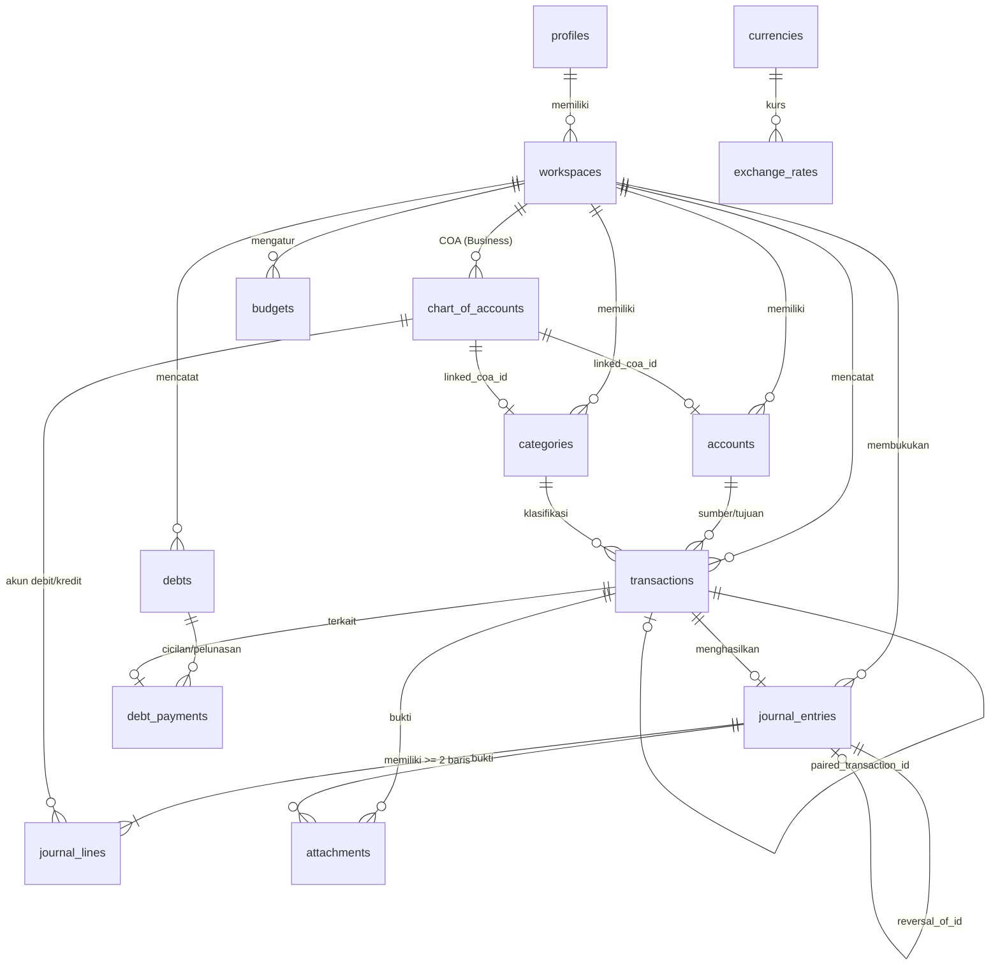
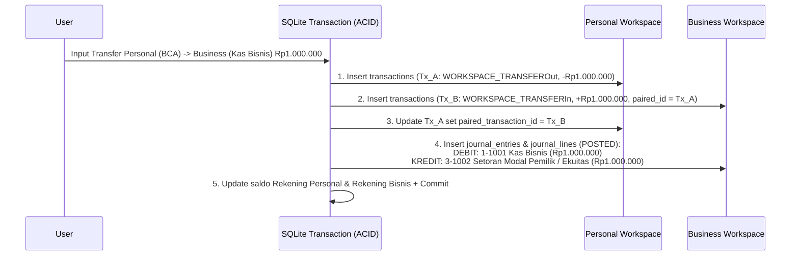

# Plan: Review Database Schema & Accounting Engine Detail (Pre-PRD)

> [!IMPORTANT]
> **Status Review:** Tahap **UI/UX & Design System (Modern Colorful + Hybrid Navigation)** telah **Disepakati & Dikunci**.
> Sekarang kita masuk ke tahap **Review Database Detail** untuk memastikan ke-17 tabel di **Expo SQLite** mendukung pencatatan Personal yang simpel, pembukuan Business berbasis **Double-Entry**, transfer antar-workspace, multi-currency, lampiran lokal, serta sistem Soft/Permanent Delete yang aman secara akuntansi.

---

## 1. Prinsip Arsitektur SQLite & Penyimpanan Lokal

Agar perhitungan uang dan pembukuan tidak pernah mengalami selisih pembulatan (*floating-point error*) maupun kerusakan data saat aplikasi tertutup tiba-tiba:

1. **Konfigurasi Engine SQLite Wajib (`PRAGMA`):**
   - `PRAGMA journal_mode = WAL;` (Write-Ahead Logging untuk performa baca/tulis cepat dan tahan *crash*).
   - `PRAGMA foreign_keys = ON;` (Menjaga integritas relasi antar-tabel).
   - Seluruh operasi multi-tabel (seperti *Posting Jurnal + Update Saldo*, atau *Transfer Antar-Workspace*) wajib dibungkus dalam satu transaksi database (`BEGIN IMMEDIATE TRANSACTION ... COMMIT / ROLLBACK`).
2. **Representasi Nominal Uang & Kurs:**
   - Disimpan menggunakan satuan terkecil integer (**Minor Units / Sen** — `INTEGER`) atau `NUMERIC/REAL` terstandarisasi dengan pembulatan presisi tinggi, ditambah penyimpanan `currency_code` dan `exchange_rate` historis pada setiap transaksi agar laporan masa lalu tidak berubah saat kurs hari ini berubah.
3. **ID & Timestamps:**
   - Primary Key menggunakan **UUID v4 / ULID (`TEXT`)** agar aman saat membuat transaksi berpasangan, *offline generation*, serta proses *backup & restore*.
   - Seluruh waktu disimpan dalam format **ISO-8601 UTC (`TEXT`)**.

---

## 2. Diagram Relasi Entitas (ERD — 17 Tabel Inti)

---

## 3. Spesifikasi Detail 17 Tabel Database

### A. Kelompok Identitas, Workspace & Mata Uang (4 Tabel)

| No | Nama Tabel | Kolom Kunci & Struktur Utama | Aturan & Kegunaan |
| :- | :--- | :--- | :--- |
| **1** | `profiles` | `id`, `full_name`, `business_name`, `avatar_uri`, `base_currency_code`, `pin_hash`, `biometric_enabled`, `onboarding_completed`, `created_at`, `updated_at` | Menyimpan profil pengguna lokal (Single-user) dan status keamanan/onboarding. |
| **2** | `workspaces` | `id`, `type` (`'PERSONAL'` \| `'BUSINESS'`), `name`, `default_currency_code`, `color_theme`, `is_active`, `created_at`, `updated_at` | Memisahkan ruang kerja Personal Finance dan Business Finance secara tegas. |
| **3** | `currencies` | `code` (PK, mis. `'IDR'`, `'USD'`), `name`, `symbol` (`'Rp'`, `'$'`), `decimal_digits` (`0` atau `2`), `is_base` (`0`/`1`), `is_active` | Daftar mata uang yang didukung untuk rekening dan transaksi multi-currency. |
| **4** | `exchange_rates` | `id`, `from_currency`, `to_currency`, `rate`, `source` (`'MANUAL'` \| `'AUTO'`), `effective_date`, `created_at` | Riwayat kurs untuk konversi transaksi lintas mata uang dan kalkulasi *Combined Dashboard*. |

---

### B. Kelompok Master Rekening, Kategori & Chart of Accounts (3 Tabel)

| No | Nama Tabel | Kolom Kunci & Struktur Utama | Aturan & Kegunaan |
| :- | :--- | :--- | :--- |
| **5** | `chart_of_accounts` | `id`, `workspace_id`, `code` (mis. `'1-1001'`), `name`, `account_type` (`'ASSET'`, `'LIABILITY'`, `'EQUITY'`, `'REVENUE'`, `'EXPENSE'`), `normal_balance` (`'DEBIT'` \| `'CREDIT'`), `parent_id`, `is_system` (`0`/`1`), `is_active`, `deleted_at` | Daftar akun akuntansi standar untuk Business Workspace. Dilengkapi *template COA UMKM default* saat onboarding. |
| **6** | `accounts` | `id`, `workspace_id`, `name`, `type` (`'CASH'`, `'BANK'`, `'EWALLET'`, `'CREDIT_CARD'`, `'INVESTMENT'`), `currency_code`, `initial_balance`, `current_balance`, `linked_coa_id` (FK ke `chart_of_accounts`, nullable di Personal, wajib di Business), `icon`, `color`, `deleted_at` | Rekening/dompet tempat menyimpan uang. Di Business, setiap rekening otomatis terhubung ke akun Aset Kas/Bank di COA. |
| **7** | `categories` | `id`, `workspace_id`, `name`, `type` (`'INCOME'` \| `'EXPENSE'`), `parent_id`, `linked_coa_id` (FK ke `chart_of_accounts`, untuk auto-journal di Business), `icon`, `color`, `is_system`, `deleted_at` | Kategori pemasukan/pengeluaran. Di Business, kategori memetakan *Mode Transaksi Cepat* ke akun Pendapatan/Beban di COA. |

---

### C. Kelompok Transaksi & Pembukuan Double-Entry (3 Tabel)

| No | Nama Tabel | Kolom Kunci & Struktur Utama | Aturan & Kegunaan |
| :- | :--- | :--- | :--- |
| **8** | `transactions` | `id`, `workspace_id`, `type` (`'INCOME'`, `'EXPENSE'`, `'TRANSFER'`, `'WORKSPACE_TRANSFER'`), `account_id`, `to_account_id` (untuk transfer internal), `category_id`, `amount`, `currency_code`, `exchange_rate_to_base`, `base_amount`, `transaction_date`, `title`, `notes`, `paired_transaction_id` (FK self-reference untuk transfer antar-workspace), `journal_entry_id` (FK ke `journal_entries`), `deleted_at`, `created_at`, `updated_at` | Tabel transaksi utama. Di Personal berdiri sendiri secara simpel; di Business terhubung ke `journal_entries`. |
| **9** | `journal_entries` | `id`, `workspace_id`, `entry_number` (mis. `'JE-202611-0001'`), `entry_date`, `description`, `reference_no`, `source_type` (`'MANUAL'`, `'AUTO_TRANSACTION'`, `'WORKSPACE_TRANSFER'`, `'DEBT'`, `'REVERSAL'`), `status` (`'DRAFT'` \| `'POSTED'` \| `'VOIDED'`), `total_debit`, `total_credit`, `currency_code`, `exchange_rate`, `reversal_of_id` (FK self-reference), `reversed_by_id`, `posted_at`, `deleted_at` (hanya untuk DRAFT) | Header jurnal umum untuk Business Workspace. Jurnal berstatus `POSTED` bersifat *immutable* (terkunci). |
| **10** | `journal_lines` | `id`, `journal_entry_id` (FK `ON DELETE CASCADE` untuk draft), `line_order`, `coa_id` (FK ke `chart_of_accounts`), `account_id` (opsional, jika menyentuh rekening kas/bank), `debit_amount`, `credit_amount`, `memo` | Baris detail Debit & Kredit. Setiap `journal_entry` wajib punya minimal 2 baris dan `SUM(debit_amount) == SUM(credit_amount)`. |

---

### D. Kelompok Anggaran, Utang/Piutang & Lampiran (4 Tabel)

| No | Nama Tabel | Kolom Kunci & Struktur Utama | Aturan & Kegunaan |
| :- | :--- | :--- | :--- |
| **11** | `budgets` | `id`, `workspace_id`, `name`, `category_id`, `amount_limit`, `currency_code`, `period_type` (`'MONTHLY'`, `'YEARLY'`, `'CUSTOM'`), `start_date`, `end_date`, `alert_threshold_percent` (default `80`), `deleted_at` | Mengatur batas anggaran per kategori atau target tabungan (*Goals & Budgets*). |
| **12** | `debts` | `id`, `workspace_id`, `type` (`'PAYABLE'` / Utang \| `'RECEIVABLE'` / Piutang), `counterparty_name`, `counterparty_contact`, `principal_amount`, `remaining_amount`, `currency_code`, `exchange_rate`, `issue_date`, `due_date`, `status` (`'UNPAID'`, `'PARTIAL'`, `'PAID'`), `linked_coa_id`, `notes`, `deleted_at` | Pencatatan utang dan piutang baik di Personal maupun Business (AR/AP). |
| **13** | `debt_payments` | `id`, `debt_id` (FK ke `debts`), `transaction_id` (FK ke `transactions`), `journal_entry_id` (opsional, untuk Business), `amount_paid`, `payment_date`, `notes`, `deleted_at` | Riwayat pembayaran cicilan atau pelunasan utang/piutang. |
| **14** | `attachments` | `id`, `workspace_id`, `owner_type` (`'TRANSACTION'` \| `'JOURNAL'` \| `'DEBT'`), `owner_id`, `file_name`, `file_rel_path` (path relatif di dalam folder dokumen aplikasi), `mime_type` (`image/jpeg`, `image/png`, `application/pdf`, dll.), `file_size_bytes`, `checksum_sha256`, `deleted_at`, `created_at` | Menyimpan metadata file bukti transaksi lokal agar mudah di-preview dan dibundel ke dalam file Backup. |

---

### E. Kelompok Audit, Pengaturan & Backup (3 Tabel)

| No | Nama Tabel | Kolom Kunci & Struktur Utama | Aturan & Kegunaan |
| :- | :--- | :--- | :--- |
| **15** | `audit_logs` | `id`, `workspace_id`, `entity_type`, `entity_id`, `action` (`'CREATE'`, `'UPDATE'`, `'POST_JOURNAL'`, `'REVERSE_JOURNAL'`, `'SOFT_DELETE'`, `'RESTORE'`, `'PERMANENT_DELETE'`), `old_payload_json`, `new_payload_json`, `created_at` | Mencatat seluruh jejak perubahan penting, penghapusan, dan pembalikan jurnal. |
| **16** | `settings` | `key` (PK, mis. `'theme_mode'`, `'language'`, `'auto_exchange_rate'`, `'default_workspace_id'`), `value_json`, `updated_at` | Key-value store untuk preferensi aplikasi (Light/Dark, ID/EN, Kurs, dll.). |
| **17** | `backups` | `id`, `file_name`, `file_path`, `backup_type` (`'NORMAL'` \| `'ENCRYPTED'`), `size_bytes`, `Attachment_count`, `db_schema_version`, `checksum_sha256`, `created_at`, `restored_at` | Riwayat file backup yang dibuat atau dipulihkan di perangkat. |

---

## 4. Mekanisme Accounting Engine & Aturan Integritas Bisnis

### 4.1. Jembatan "Mode Transaksi Cepat" ke Double-Entry (Business Workspace)
Saat pengguna di **Business Workspace** menggunakan *Mode Transaksi Cepat* (tanpa memilih Debit/Kredit manual), sistem bekerja secara atomik menggunakan pemetaan `linked_coa_id`:

| Jenis Transaksi Cepat | Baris 1 (DEBIT) | Baris 2 (KREDIT) |
| :--- | :--- | :--- |
| **Pemasukan Tunai/Bank** (mis. Penjualan Rp500.000) | `accounts.linked_coa_id` (Mis: `1-1001 Kas / Bank`) — **Rp500.000** | `categories.linked_coa_id` (Mis: `4-1001 Pendapatan Penjualan`) — **Rp500.000** |
| **Pengeluaran Tunai/Bank** (mis. Biaya Listrik Rp200.000) | `categories.linked_coa_id` (Mis: `5-2001 Beban Listrik`) — **Rp200.000** | `accounts.linked_coa_id` (Mis: `1-1001 Kas / Bank`) — **Rp200.000** |
| **Transfer Antar-Rekening Bisnis** (Bank BCA ke Kas Kecil) | `to_account.linked_coa_id` (`1-1002 Kas Kecil`) | `from_account.linked_coa_id` (`1-1001 Bank BCA`) |

### 4.2. Alur Database untuk Transfer Antar-Workspace (Personal ↔ Business)

- **Aturan Pembatalan / Soft Delete Transfer Antar-Workspace:**
  Jika pengguna membatalkan atau menghapus `Tx_A` di Personal (atau `Tx_B` di Business), sistem otomatis menarik `paired_transaction_id`, membatalkan kedua transaksi di kedua workspace, mengembalikan saldo kedua rekening, dan otomatis membuat **Jurnal Pembalik (Reversal Entry)** di Business Workspace dalam satu transaksi SQLite yang sama.

### 4.3. Aturan Soft Delete vs Permanent Delete di Level Database

| Entitas Data | Saat Soft Delete (`deleted_at = NOW()`) | Saat Permanent Delete (`DELETE FROM ...`) |
| :--- | :--- | :--- |
| **Transaksi Personal** | Masuk ke Trash, saldo rekening dikembalikan, tidak dihitung di dashboard/laporan. | Dihapus permanen dari DB + file lampiran yang tidak dipakai dihapus dari storage. |
| **Jurnal Bisnis (`DRAFT`)** | Masuk ke Trash, belum memengaruhi laporan. | Bisa dihapus permanen beserta `journal_lines`-nya. |
| **Jurnal Bisnis (`POSTED`)** | **Dilarang Soft/Permanent Delete langsung!** Harus melalui fitur **"Buat Jurnal Pembalik (Reverse)"** agar jejak audit dan histori buku besar tetap utuh. | **Ditolak oleh sistem** (`PROTECTED_POSTED_JOURNAL`). |
| **Master Rekening / Kategori / COA** | Bisa di-*soft delete* / *archive* (disembunyikan dari pilihan input baru). | **Ditolak** jika `COUNT(transactions / journal_lines) > 0`. Hanya bisa dihapus permanen jika belum pernah dipakai sama sekali. |

### 4.4. Rumus Perhitungan 6 Laporan Akuntansi dari SQLite
Seluruh 6 laporan akuntansi bisnis dihitung langsung dengan query SQL dari `journal_entries` yang berstatus `status = 'POSTED'` dan `deleted_at IS NULL`:
1. **Jurnal Umum:** `SELECT` kronologis dari `journal_entries` + `journal_lines`.
2. **Buku Besar (General Ledger):** Filter `journal_lines` berdasarkan `coa_id`, diurutkan per tanggal dengan *window function* `SUM(debit - credit) OVER (ORDER BY entry_date, id)` untuk menghitung Saldo Berjalan (*Running Balance*).
3. **Neraca Saldo (Trial Balance):** `GROUP BY coa_id` untuk menjumlahkan total saldo akhir Debit dan Kredit setiap akun pada akhir periode.
4. **Laba Rugi (Profit & Loss):** Menjumlahkan akun bertipe `'REVENUE'` dikurangi `'EXPENSE'` dalam rentang tanggal (`start_date` s/d `end_date`).
5. **Neraca (Balance Sheet):** Menjumlahkan saldo kumulatif sampai `as_of_date` untuk akun `'ASSET'`, `'LIABILITY'`, dan `'EQUITY'` + *Laba Bersih Periode Berjalan*.
6. **Arus Kas (Cash Flow):** Mengelompokkan mutasi pada akun COA Kas/Bank berdasarkan kategori aktivitas (*Operasional, Investasi, Pendanaan*).

---

## 5. Arsitektur Paket Backup & Restore (Database + Lampiran)

Karena aplikasi menyimpan bukti transaksi (Foto/PDF) secara lokal, backup tidak boleh hanya menyalin file `.db`, melainkan dikemas dalam satu bundel arsip utuh:
- **Struktur Bundel Backup (`.qoubackup` / ZIP Container):**
  - `manifest.json` (Versi aplikasi, versi skema DB, timestamp, jumlah transaksi, daftar SHA-256 checksum).
  - `database.sqlite` (Snapshot bersih SQLite menggunakan `VACUUM INTO`).
  - `attachments/` (Seluruh file foto, PNG, dan PDF bukti transaksi).
- **Mode Backup Terenkripsi:**
  - Seluruh bundel dienkripsi menggunakan **AES-256-GCM** dengan kunci yang diturunkan dari *password backup* pengguna melalui **PBKDF2 / Argon2**.

---

## 6. Status Concept Review & Konfirmasi

| Tahap Review | Status |
| :--- | :--- |
| 1. Identitas & Teknologi | **Disepakati** |
| 2. Workspace & Pengguna | **Disepakati** |
| 3. Akuntansi & Transaksi | **Disepakati** |
| 4. Keamanan & Backup | **Disepakati** |
| 5. UI/UX & Design System (Modern Colorful + Hybrid Nav) | **Disepakati** |
| 6. **Database Schema & Accounting Engine Detail (17 Tabel)** | **Siap Dikunci (Menunggu Approval Anda)** |
| 7. Development Plan & Architecture Detail | *Tahap Terakhir Sebelum Final PRD* |

### Pertanyaan Konfirmasi untuk Anda:
1. **Template Chart of Accounts (COA) Bawaan:** Saat pengguna membuat Business Workspace untuk pertama kali, apakah Anda setuju aplikasi otomatis melakukan *seeding* (mengisi awal) **Daftar Akun COA Standar UMKM Indonesia & Inggris** (seperti *Kas, Bank, Piutang Usaha, Utang Usaha, Modal Pemilik, Prive, Pendapatan Penjualan, HPP, Beban Operasional*) sehingga pengguna bisa langsung memakai aplikasi tanpa harus membuat akun akuntansi dari nol?
2. Apakah struktur **17 tabel dan aturan integritas Double-Entry** di atas sudah sesuai untuk kita kunci dan lanjut ke tahap review terakhir sebelum PRD: **Development Plan & Folder Architecture Detail**?
