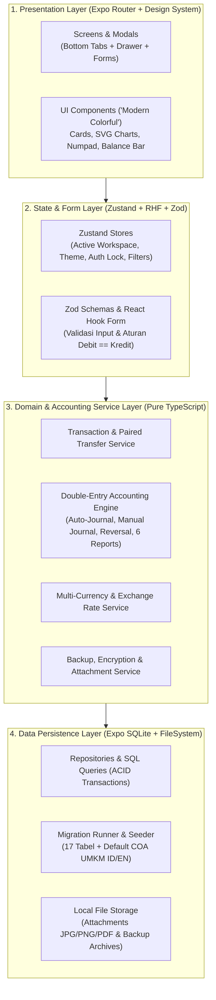
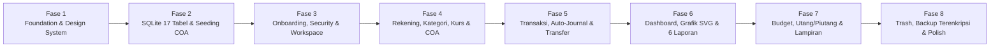

# Plan: Development Plan & Project Architecture Detail (Pre-PRD — Tahap Akhir)

> [!IMPORTANT]
> **Status Review:**
> - **Database Schema (17 Tabel SQLite) & Accounting Engine Detail** + **Default Seeding COA UMKM Bilingual (ID/EN)** telah **Disepakati & Dikunci**.
> - Ini adalah **tahap review terakhir (Tahap 7)** sebelum seluruh keputusan disatukan menjadi **Final PRD (Product Requirements Document)**. Kita masih belum menulis kode aplikasi pada tahap ini.

---

## 1. Arsitektur Aplikasi (Local-First Clean Modular Architecture)

Karena aplikasi berjalan **100% Local-First tanpa backend server**, seluruh logika bisnis, validasi jurnal akuntansi (`Debit == Kredit`), konversi multi-currency, dan manajemen transaksi ACID berada di dalam aplikasi mobile. Oleh karena itu, kita memisahkan arsitektur ke dalam **4 Layer Tegas** agar kode rapi, mudah diuji, dan bebas bug:



---

## 2. Struktur Folder Proyek (`src/` & `app/`)

Menggunakan **Expo Router (File-based routing)** untuk navigasi **Hybrid (5-Tab Bottom Navigation + Drawer)** yang dipadukan dengan folder modular `src/`:

```text
financial-management-app/
├── app/                                  # Expo Router Navigation
│   ├── _layout.tsx                       # Root Layout (DB Init, Theme, Lock Screen Guard)
│   ├── (onboarding)/                     # Flow Onboarding Wajib (4 Step)
│   ├── (auth)/                           # Layar Kunci PIN & Biometrik
│   ├── (drawer)/                         # Hybrid Navigation: Sidebar Drawer Wrapper
│   │   ├── _layout.tsx                   # Custom Drawer Content (Kontekstual Workspace)
│   │   ├── (tabs)/                       # 5 Menu Utama Bottom Navigation
│   │   │   ├── _layout.tsx               # Bottom Tab Bar + Center Floating (+) Button
│   │   │   ├── index.tsx                 # 1. Home (Personal / Business / Combined Dashboard)
│   │   │   ├── activity.tsx              # 2. Activity (Daftar Transaksi & Filter)
│   │   │   ├── reports.tsx               # 4. Reports (Grafik Donut/Bar & Laporan)
│   │   │   └── settings.tsx              # 5. Settings (Tema, Bahasa, Keamanan, Kurs)
│   │   ├── accounts/                     # Rekening & Dompet
│   │   ├── categories/                   # Manajemen Kategori
│   │   ├── budgets/                      # Budget & Goals
│   │   ├── debts/                        # Utang & Piutang + Cicilan
│   │   ├── accounting/                   # Modul Khusus Business Accounting
│   │   │   ├── coa.tsx                   # Chart of Accounts (Daftar Akun)
│   │   │   ├── journals.tsx              # Jurnal Umum (General Journal)
│   │   │   ├── ledger.tsx                # Buku Besar (General Ledger)
│   │   │   ├── trial-balance.tsx         # Neraca Saldo
│   │   │   ├── profit-loss.tsx           # Laba Rugi
│   │   │   ├── balance-sheet.tsx         # Neraca
│   │   │   └── cash-flow.tsx             # Arus Kas
│   │   ├── currencies/                   # Multi-Currency & Riwayat Kurs
│   │   ├── trash/                        # Trash & Recovery (Soft Delete & Permanent Delete)
│   │   └── backup/                       # Backup & Restore (Normal + Encrypted)
│   └── modals/                           # Form Input & Detail Modals
│       ├── add-transaction.tsx           # Form Transaksi (Personal & Business Auto-Journal)
│       ├── add-journal.tsx               # Form Jurnal Manual Debit/Kredit
│       ├── workspace-transfer.tsx        # Form Transfer Antar-Workspace (Paired Tx)
│       └── attachment-preview.tsx        # Preview Foto / PDF Bukti Transaksi
│
├── src/
│   ├── database/                         # Expo SQLite Layer
│   │   ├── client.ts                     # Koneksi DB, PRAGMA WAL & Foreign Keys
│   │   ├── migrations/                   # Script DDL 17 Tabel & Versi Skema
│   │   ├── seeds/                        # Default Currencies, Categories, & COA UMKM (ID/EN)
│   │   └── repositories/                 # Query SQL Terisolasi per Modul
│   ├── services/                         # Business Logic & Accounting Engine
│   │   ├── accounting-engine.service.ts  # Validasi Dr=Cr, Auto-Journal, Reversal, 6 Reports
│   │   ├── transaction.service.ts        # CRUD Transaksi & Paired Workspace Transfer
│   │   ├── currency.service.ts           # Konversi Kurs & Kalkulasi Combined Dashboard
│   │   ├── attachment.service.ts         # Kamera/File Picker, Copy Lokal, Checksum SHA-256
│   │   ├── trash.service.ts              # Soft Delete, Restore, & Cek Proteksi Relasi
│   │   └── backup.service.ts             # Bundel DB + Attachments & Enkripsi AES-256
│   ├── stores/                           # Zustand State Management
│   │   ├── useWorkspaceStore.ts          # Active Workspace (Personal | Business | Combined)
│   │   ├── useAppLockStore.ts            # Status Lock PIN & Biometrik
│   │   └── useSettingsStore.ts           # Tema (Light/Dark), Bahasa (ID/EN), Base Currency
│   ├── theme/                            # Design System "Modern Colorful"
│   │   ├── colors.ts                     # Palet Ungu, Biru, Hijau, Merah, Kuning (Light & Dark)
│   │   ├── typography.ts                 # Font Inter + Tabular Numbers
│   │   └── spacing.ts                    # Grid 4/8px & Border Radius 12-28px
│   ├── components/                       # Reusable UI Components (React Native StyleSheet)
│   │   ├── ui/                           # Button, Card, PillBadge, Modal, Skeleton
│   │   ├── charts/                       # DonutChart, BarChart, CircularProgress (RN SVG)
│   │   ├── workspace/                    # WorkspaceSwitcherPill, HeroBalanceHeader
│   │   └── accounting/                   # JournalLineCard, StickyBalanceFooter
│   ├── i18n/                             # Lokalisasi Bahasa (id.json & en.json)
│   └── utils/                            # Formatter Uang, Tanggal, & Kalkulator Mini
```

---

## 3. Roadmap Pengembangan Bertahap (8 Fase Implementasi)

Untuk memastikan setiap modul terbangun dengan fondasi yang kuat dan mudah ditesting, pembangunan aplikasi setelah PRD selesai akan dibagi menjadi **8 Fase Berurutan**:



### Rincian Fase & Deliverable:

| Fase | Fokus Pembangunan | Deliverable Utama |
| :--- | :--- | :--- |
| **Fase 1: Project Setup & Design System** | Inisialisasi Expo + TypeScript, konfigurasi Expo Router, sistem tema **Modern Colorful** (Light & Dark Mode), lokalisasi `ID/EN`, dan komponen UI dasar. | Kerangka navigasi **Hybrid (5-Tab Bottom Nav + Drawer)** berjalan mulus dengan tema Ungu/Biru. |
| **Fase 2: Database Layer & Seeding** | Implementasi koneksi Expo SQLite (`WAL`, `foreign_keys=ON`), *migration runner* untuk **17 Tabel**, serta *Seeder* otomatis (Mata uang, Kategori Personal, dan **Template COA UMKM ID/EN**). | Database siap pakai begitu aplikasi dibuka pertama kali. |
| **Fase 3: Onboarding, Security & Workspace** | Alur Onboarding wajib (4 langkah), layar kunci **PIN + Biometrik**, serta **Workspace Switcher Pill** (`Personal`, `Business`, `Combined`). | Pengguna dapat menyelesaikan setup awal, mengunci aplikasi, dan berpindah workspace. |
| **Fase 4: Master Data & Multi-Currency** | Modul **Accounts & Wallets**, **Category Management**, **Chart of Accounts (COA)**, serta **Multi-Currency & Exchange Rates** (kurs manual & otomatis). | Pengguna dapat mengelola dompet multi-mata uang dan bagan akun akuntansi bisnis. |
| **Fase 5: Core Transaction & Double-Entry Engine** | Form input transaksi Personal, **Business Auto-Journal**, **Form Jurnal Manual Debit/Kredit** (dengan *Sticky Balance Bar* & *Jurnal Pembalik*), serta **Transfer Antar-Workspace** berpasangan. | Mesin pencatatan transaksi dan akuntansi double-entry berfungsi penuh secara atomik (ACID). |
| **Fase 6: Dashboards, SVG Charts & 6 Laporan Akuntansi** | **Personal, Business, & Combined Dashboard** (dengan konversi kurs), grafik Donut & Bar (`react-native-svg`), serta **6 Laporan Akuntansi Bisnis** (*Jurnal Umum, Buku Besar, Neraca Saldo, Laba Rugi, Neraca, Arus Kas*). | Visualisasi laporan keuangan personal dan bisnis tampil akurat secara *real-time*. |
| **Fase 7: Budget, Debt & Attachments** | Modul **Budget & Goals** (dengan *circular progress ring*), **Debt & Receivables** (cicilan utang/piutang), serta **Attachments** (kamera, galeri, PDF, preview). | Seluruh fitur manajemen keuangan lanjutan dan bukti transaksi lokal terintegrasi. |
| **Fase 8: Trash, Backup/Restore & QA Polish** | Modul **Trash & Recovery** (*Soft Delete*, *Restore*, proteksi *Permanent Delete*), **Backup & Restore** (Normal + Enkripsi AES-256 beserta lampiran), audit performa, dan konfigurasi **EAS Build**. | Aplikasi siap dibuild ke APK/AAB (Android) dan iOS dengan kualitas produksi. |

---

## 4. Standar Kualitas & Pengujian (Quality Gates)

1. **Accounting Invariant Guard:**
   - Setiap transaksi yang memposting jurnal wajib melewati fungsi verifikasi:
     $$\sum \text{Debit} = \sum \text{Kredit} \quad \text{dan} \quad \text{Jumlah Baris} \ge 2$$
   - Neraca (*Balance Sheet*) wajib selalu memenuhi persamaan akuntansi dasar:
     $$\text{Total Aset} = \text{Total Liabilitas} + \text{Total Ekuitas} + \text{Laba/Rugi Bersih Berjalan}$$
2. **Paired Transfer Consistency Check:**
   - Pengujian otomatis bahwa setiap transfer `Personal ↔ Business` selalu memiliki pasangan yang sah dan tidak pernah masuk ke perhitungan Laba Rugi Bisnis.
3. **Offline & Restore Integrity Check:**
   - Memastikan proses *Restore Backup* memvalidasi *checksum SHA-256* sebelum menggantikan database aktif, sehingga jika file backup rusak, data lama pengguna tetap aman 100%.

---

## 5. Status Seluruh Tahap Pre-PRD

| Tahap Review | Status |
| :--- | :--- |
| 1. Identitas & Teknologi | **Disepakati** |
| 2. Workspace & Pengguna | **Disepakati** |
| 3. Akuntansi & Transaksi | **Disepakati** |
| 4. Keamanan & Backup | **Disepakati** |
| 5. UI/UX & Design System (Modern Colorful + Hybrid Nav) | **Disepakati** |
| 6. Database Schema & Accounting Engine Detail (17 Tabel + Default COA) | **Disepakati** |
| 7. **Development Plan & Project Architecture Detail (8 Fase)** | **Siap Dikunci (Menunggu Approval Anda)** |

---

### Konfirmasi Terakhir Sebelum Pembuatan Final PRD:
Apakah **Development Plan & Arsitektur 8 Fase** di atas sudah sesuai?
- Jika **Ya**, seluruh 7 tahap review Pre-PRD telah **100% lengkap dan disetujui**, dan pada langkah berikutnya saya akan menyusun dokumen **Final PRD (Product Requirements Document) v1.0** yang menyatukan seluruh spesifikasi konsep, UI/UX, database, dan arsitektur ini sebagai acuan resmi sebelum mulai coding.
