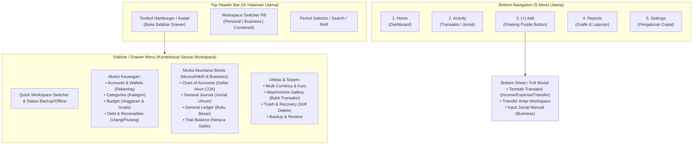

# UI/UX & Design System Plan — Financial Management & Accounting App (Pre-PRD)

> [!IMPORTANT]
> **Keputusan Kunci yang Sudah Dikunci:**
> 1. **Gaya Visual:** **D. Modern Colorful** (Dominasi Ungu & Biru dengan aksen warna ekspresif untuk kategori, grafik donut/bar, dan progress bar; tetap bersih, rapi, dan profesional).
> 2. **Arsitektur Navigasi:** **C. Hybrid Navigation** (**5-Tab Bottom Navigation** dengan tombol tengah `+` mengambang untuk menu harian utama + **Slide-Over Sidebar / Drawer** untuk modul akuntansi lengkap, pengelolaan data master, dan utilitas).

---

## 1. Identitas Visual & Design System ("Modern Colorful")

Mengambil inspirasi langsung dari referensi desain yang Anda pilih:
- **Hero Header Berwarna Ungu Lembut (Purple Hero Container)** di bagian atas Dashboard dengan teks saldo putih yang sangat kontras, diikuti oleh **Main Content Sheet Putih/Charcoal** dengan sudut atas membulat besar (`24px–28px`).
- **Kartu Ringkasan (Summary Cards)** bersih dengan latar permukaan terang/gelap, ikon dalam *soft tinted circle/squircle*, dan indikator persentase/status berbentuk *pill badge*.
- **Floating Center Action Button (`+`)** berwarna ungu cerah dengan efek bayangan lembut di tengah Bottom Navigation.

### 1.1. Palet Warna (Color Tokens — Light & Dark Mode)

| Token / Peran | Light Mode | Dark Mode | Penggunaan di UI |
| :--- | :--- | :--- | :--- |
| **Primary Brand (Ungu)** | `#7C3AED` (Violet 600) | `#8B5CF6` (Violet 500) | Hero Header Dashboard, Floating `+` Button, Tab Aktif, Progress utama |
| **Primary Soft / Tint** | `#F3E8FF` (Violet 100) | `#2E1065` (Violet 950) | Latar badge, lingkaran ikon, pill selector aktif |
| **Secondary Brand (Biru)** | `#2563EB` (Blue 600) | `#3B82F6` (Blue 500) | Aksen kedua, grafik, kategori, indikator transfer & Business badge |
| **Positive / Income (Hijau)** | `#10B981` (Emerald 500) | `#34D399` (Emerald 400) | Pemasukan (`+`), indikator jurnal *Balanced* (`Dr = Cr`), tren naik |
| **Negative / Expense (Merah/Coral)** | `#EF4444` (Red 500) | `#F87171` (Red 400) | Pengeluaran (`-`), indikator *Unbalanced*, peringatan *Over-budget* |
| **Warning / Accent (Kuning/Amber)** | `#F59E0B` (Amber 500) | `#FBBF24` (Amber 400) | Tabungan/Goals, pengingat jatuh tempo utang/piutang, kategori |
| **Background Utama** | `#F8F9FE` (Cool White) | `#0B0D17` (Deep Charcoal) | Latar belakang utama layar di luar kartu |
| **Surface / Card** | `#FFFFFF` (Pure White) | `#15192B` (Dark Navy-Slate) | Kartu transaksi, kartu anggaran, drawer, bottom sheet |
| **Text Primary** | `#111827` (Gray 900) | `#F9FAFB` (Gray 50) | Nominal utama, judul halaman, nama transaksi |
| **Text Secondary / Muted** | `#6B7280` (Gray 500) | `#9CA3AF` (Gray 400) | Tanggal, sub-judul, nama rekening, keterangan |
| **Border & Divider** | `#EEF2F6` | `#232942` | Garis pemisah kartu dan tabel jurnal |

### 1.2. Identitas Warna Workspace (Satu Design System, Beda Nuansa Header)
Agar pengguna langsung sadar sedang berada di workspace mana tanpa merusak tema **Modern Colorful**:
- **Personal Workspace:** Hero Header **Signature Purple** (`#7C3AED` → `#9333EA`).
- **Business Workspace:** Hero Header **Royal Indigo-Blue** (`#3B82F6` → `#1D4ED8`).
- **Combined Overview:** Hero Header **Deep Violet-Indigo** (`#4F46E5` → `#7C3AED`) dengan badge `"Personal + Business"`.

### 1.3. Tipografi, Spacing & Bentuk Komponen
| Elemen | Spesifikasi |
| :--- | :--- |
| **Font Family** | **Inter** (`Regular 400`, `Medium 500`, `SemiBold 600`, `Bold 700`) + `tabular-nums` untuk seluruh angka & nominal |
| **Ukuran Teks** | Hero Balance: `32px Bold` · Judul Halaman: `20px SemiBold` · Card Value: `18px Bold` · Body/List: `14px–15px Medium` · Caption/Badge: `12px` |
| **Border Radius** | Hero Sheet Top Radius: `28px` · Kartu Utama: `16px` · Kartu Kecil / Input: `12px` · Pill Badge: `999px` |
| **Spacing System** | Grid kelipatan `4px` / `8px` (Padding layar horizontal: `16px` atau `20px`, jarak antar-kartu: `12px–16px`) |
| **Iconography** | **Lucide React Native** (`strokeWidth: 2`, ukuran `20px–24px`, diletakkan di dalam *tinted squircle* `40x40px`) |
| **Animation** | Halus & ringan (`150ms–250ms` easing) untuk transisi workspace, drawer slide, dan progress ring agar tetap mulus di HP spesifikasi rendah |

---

## 2. Arsitektur Navigasi: Model C (Hybrid Navigation)

Dengan **Hybrid Navigation**, layar utama tetap bersih seperti aplikasi referensi (hanya 5 menu bawah), sedangkan fitur mendalam seperti **6 Laporan Akuntansi, Buku Besar, Chart of Accounts, Trash, dan Kurs Mata Uang** tersusun rapi di dalam **Sidebar Drawer**.

### Pembagian Peran Bottom Navigation vs Drawer:
1. **Bottom Navigation (5 Menu Harian):**
   - **Home:** Dashboard ringkasan saldo, kartu *Income vs Expense*, *Insight/Quick Banner*, dan *Recent Transactions*.
   - **Activity:** Daftar seluruh transaksi (dilengkapi pencarian, filter tanggal/kategori/rekening, serta tab toggle *Transaksi* vs *Jurnal* saat di Business).
   - **`+` (Add — Tombol Ungu Tengah):** Membuka form tambah transaksi (atau pilihan cepat: *Transaksi Baru*, *Transfer Antar-Workspace*, *Jurnal Umum*).
   - **Reports:** Grafik Donut/Bar yang berwarna-warni (di Personal) serta akses tab laporan keuangan utama (*Laba Rugi, Neraca, Arus Kas* di Business).
   - **Settings:** Pengaturan tema (Light/Dark), bahasa (ID/EN), keamanan (PIN/Biometrik), mata uang utama, dan backup.
2. **Sidebar / Drawer (Menu Lengkap & Manajemen Modul):**
   - Diakses dengan menyentuh tombol menu/avatar di kiri atas atau *swipe* dari tepi kiri layar.
   - Menyediakan jalan pintas langsung ke **Accounts & Wallets**, **Budget & Goals**, **Debt (Utang/Piutang)**, **Chart of Accounts (COA)**, **General Journal**, **General Ledger**, **Trial Balance**, **Multi-Currency**, dan **Trash & Recovery**.

---

## 3. Rencana Desain 13 Halaman Utama (Screen-by-Screen Plan)

Berikut spesifikasi tata letak (*layout*) untuk ke-13 halaman agar selaras dengan gaya **Modern Colorful**:

### 3.1. Onboarding & Setup Awal (Wajib saat Pertama Kali)
- **Step 1 — Welcome Carousel:** Ilustrasi modern bertema ungu-biru (*"Satu Aplikasi untuk Keuangan Pribadi & Pembukuan Bisnis"*).
- **Step 2 — Pilih Bahasa & Mata Uang Utama:** Pilih Bahasa (`Indonesia` / `English`) dan Base Currency (mis. `IDR - Rupiah`).
- **Step 3 — Setup Workspace & Rekening Awal:** Mengaktifkan workspace (`Personal`, `Business`, atau keduanya) dan membuat dompet pertama (mis. Kas Tunai / Rekening Bank).
- **Step 4 — Setup Keamanan:** Buat 6-digit PIN + opsi aktifkan *Biometrics* (Fingerprint / Face Unlock).

### 3.2. Security (PIN & Biometrik)
- Layar kunci bergaya bersih dengan latar ungu gelap/terang, indikator 6 titik PIN, tombol *numpad* bulat modern, dan tombol cepat *Biometric Unlock*.

### 3.3. Dashboard (Home) & Workspace Switcher
Mengikuti referensi gambar **Screen 1 (Kiri)**:
- **Top Bar:** Tombol Drawer/Profil di kiri, **Workspace Switcher Pill** (`Personal` / `Business` / `Combined`) + **Filter Periode (`November 2026 v`)** di tengah, tombol Notifikasi/Status Backup di kanan.
- **Purple Hero Section:**
  - Label `"Total Balance"` / `"Total Saldo"`
  - Nominal Utama Besar (`Rp25.750.000`)
  - Pill tren di bawah saldo (mis. `"+Rp784.000 dibanding bulan lalu"` atau breakdown `"Personal Rp8,25 Jt · Business Rp17,5 Jt"` saat di mode Combined).
- **White/Dark Rounded Content Sheet:**
  - **Your Money Section (2 Kartu Sejajar):** Kartu **Income** (ikon hijau/biru muda) & Kartu **Expense** (ikon merah/oranye muda).
  - **Quick Insight / Accounting Status Banner:** Bar gelap kontras (seperti *"Your insight is ready"* di gambar) untuk menampilkan ringkasan cepat, misalnya: *"Neraca Saldo Seimbang ✓"* di Business atau *"3 Anggaran hampir mencapai batas"* di Personal.
  - **Recent Transactions:** Daftar transaksi terbaru dikelompokkan per tanggal, lengkap dengan ikon kategori berwarna, nama rekening, badge workspace, dan nominal berwarna (Hijau untuk `+`, Merah untuk `-`).

### 3.4. Transactions (Activity)
- **Search Bar & Filter Chips** di bagian atas (`Semua`, `Pemasukan`, `Pengeluaran`, `Transfer`, `Ada Lampiran`).
- Daftar transaksi dikelompokkan per hari dengan *sub-total harian* di sebelah kanan tanggal (persis seperti referensi gambar).
- *Swipe action* atau tap untuk melihat detail, preview lampiran foto/PDF, atau *Soft Delete* (pindah ke Trash).

### 3.5. Add Transaction (Form Input Transaksi)
- **Segmented Control di Atas:**
  - Di **Personal:** `Pengeluaran` | `Pemasukan` | `Transfer`
  - Di **Business:** `Transaksi Cepat (Auto-Journal)` | `Jurnal Manual` | `Transfer`
- **Big Amount Display:** Input angka besar di bagian atas dengan pemilih mata uang (jika multi-currency, langsung muncul baris kurs otomatis/manual).
- **Form Fields Modern:**
  - Pemilih **Kategori** (grid/bottom sheet dengan ikon warna-warni) dan **Rekening/Dompet**.
  - Khusus **Transfer Antar-Workspace (Personal ↔ Business)**: Menampilkan kartu *Source Workspace & Account* → *Target Workspace & Account* beserta akun ekuitas penyeimbang (*Setoran Modal / Prive*) agar tidak tercatat sebagai pendapatan bisnis.
  - Input **Tanggal**, **Catatan**, dan **Lampiran Bukti** (tombol Kamera, Galeri, Pilih PDF/Dokumen dengan preview *thumbnail*).
  - Khusus **Business (Mode Transaksi Cepat)**: Tombol **"Preview Jurnal Debit/Kredit"** di atas tombol Simpan agar pengguna bisa mengecek pasangan akun sebelum memposting.

### 3.6. Journal (Jurnal Umum & Form Debit/Kredit — Business)
- **Daftar Jurnal Umum:** Kartu per transaksi jurnal yang menampilkan No. Jurnal, Tanggal, Keterangan, Status (`POSTED` / `DRAFT`), dan rincian baris akun Debit vs Kredit.
- **Form Jurnal Manual:**
  - Daftar baris jurnal dinamis (minimal 2 baris). Tombol `+ Tambah Baris Akun`.
  - **Sticky Balance Footer:** Menampilkan `Total Debit` vs `Total Kredit`. Berwarna **Hijau** jika seimbang (`Balance ✓`) dan **Merah** jika masih selisih.
  - **Aturan Koreksi:** Jurnal yang sudah `POSTED` tidak bisa diedit/dihapus permanen; di halaman detailnya terdapat tombol **"Buat Jurnal Pembalik (Reverse)"** atau **"Jurnal Penyesuaian"**.

### 3.7. Reports (Grafik & Laporan Keuangan)
Mengikuti referensi gambar **Screen 2 (Tengah)**:
- **Segmented Toggle & Period Picker** di bagian atas.
- **Visual Analytics (Personal & Business Overview):**
  - **Multi-Segment Donut Chart** besar di tengah dengan Total Nominal di dalam lingkaran dan *tooltip badge* persentase (mis. `31%`).
  - **Category Breakdown Cards** di bawah grafik: Ikon kategori berwarna, nama kategori, persentase dari total, *mini progress bar* berwarna (ungu, biru, oranye, hijau), dan badge perbandingan (`+12% vs bulan lalu`).
- **Business Financial Statements (6 Laporan Akuntansi):**
  - Tab/Menu untuk membuka tampilan tabel profesional: **General Journal**, **General Ledger (Buku Besar)**, **Trial Balance (Neraca Saldo)**, **Profit & Loss (Laba Rugi)**, **Balance Sheet (Neraca)**, dan **Cash Flow (Arus Kas)**.

### 3.8. Budget & Goals (Anggaran)
Mengikuti referensi gambar **Screen 3 (Kanan)**:
- **Top Highlight Card:** Anggaran utama atau target tabungan dengan *progress bar* bergaris dan *alert banner* berwarna coral/oranye jika melebihi jadwal/batas (*"Kamu sudah menggunakan 85% anggaran bulan ini"*).
- **Budget List Cards:** Kartu per kategori dengan ikon berwarna di kiri, nominal terpakai vs batas anggaran (`Rp1.250.000 dari Rp2.500.000`), dan **Circular Progress Ring** (`55%`, `25%`, `65%`) di sisi kanan.

### 3.9. Accounts (Rekening & Dompet) + Chart of Accounts (COA)
- **Accounts & Wallets:** Kartu visual untuk setiap rekening (Kas, Bank, E-Wallet) lengkap dengan mata uangnya, saldo saat ini, dan riwayat mutasi.
- **Chart of Accounts (Khusus Business):** Daftar akun akuntansi yang dikelompokkan berdasarkan 5 tipe utama (`1-Aset`, `2-Liabilitas`, `3-Ekuitas`, `4-Pendapatan`, `5-Beban`) dengan kode akun dan saldo normal (`Debit`/`Kredit`).

### 3.10. Debt (Utang & Piutang)
- Tab `Utang Saya (Payables)` dan `Piutang (Receivables)`.
- Kartu per kontak/pihak dengan *progress bar* pelunasan, tanggal jatuh tempo, dan tombol **"Catat Pembayaran Cicilan/Pelunasan"** yang otomatis memotong sisa utang dan mencatat transaksi/jurnal.

### 3.11. Backup, Trash & Settings
- **Backup & Restore:** Pilihan **Backup Normal** atau **Backup Terenkripsi (Password-Protected)** yang membungkus database SQLite beserta folder lampiran bukti transaksi, lengkap dengan indikator waktu backup terakhir.
- **Trash & Recovery:** Daftar item yang terkena *Soft Delete* dengan tombol `Restore` dan `Permanent Delete` (dengan pengecekan integritas relasi).
- **Settings:** Toggle *Light / Dark Mode*, *Bahasa (ID / EN)*, *Keamanan (Ubah PIN & Biometrik)*, serta *Pengaturan Kurs (Manual / Otomatis)*.

---

## 4. Sepuluh UX Rules Wajib (Checklist Implementasi Desain)

1. **Anti-Clutter (Kepadatan Terkontrol):** Maksimal 3–4 kelompok informasi utama dalam satu tampilan layar tanpa scroll; detail mendalam ditaruh di halaman detail atau Drawer.
2. **One-Thumb Reachability:** Tombol `+` (Tambah Transaksi) selalu berada di tengah Bottom Navigation dengan warna ungu kontras.
3. **Format Angka & Mata Uang Lokal:** Menggunakan pemisah ribuan sesuai lokal (`Rp25.750.000` atau `$42,124.67`) dan `tabular-nums`.
4. **Konversi Kurs Akurat di Combined Dashboard:** Saldo dari mata uang asing tidak pernah dijumlahkan mentah; semuanya dikonversi ke *Base Currency* menggunakan kurs tersimpan (disertai keterangan kurs acuan).
5. **Pencarian & Filter Instan:** Tersedia di halaman transaksi, jurnal umum, dan buku besar.
6. **Konfirmasi & Pembatalan Aman:** Menyediakan *confirmation dialog* sebelum membatalkan form yang sudah terisi atau saat melakukan *Permanent Delete*.
7. **State Persistence Antar-Workspace:** Berpindah dari Personal ke Business tidak mereset filter atau draf yang sedang dikerjakan.
8. **Indikator Offline & Status Backup:** Badge halus di Drawer/Header yang menunjukkan `"Offline Ready · Backup Terakhir: Hari ini 14:00"`.
9. **Full Light & Dark Mode Parity:** Seluruh komponen, grafik SVG, dan kartu menyesuaikan kontras secara otomatis di Light maupun Dark Mode.
10. **Performa Ringan untuk Low-End Devices:** Menghindari *blur* berat berlapis-lapis; menggunakan *flat/subtle shadow*, *skeleton loading* selektif, dan virtualisasi list (`FlatList`/`FlashList`) untuk ribuan transaksi.

---

## 5. Status Concept Review & Langkah Berikutnya

Dengan disepakatinya gaya **D. Modern Colorful** dan navigasi **C. Hybrid (Bottom Nav + Drawer)**, maka status review kita saat ini:

| Tahap Review | Status |
| :--- | :--- |
| 1. Identitas & Teknologi | **Disepakati** |
| 2. Workspace & Pengguna | **Disepakati** |
| 3. Akuntansi & Transaksi | **Disepakati** |
| 4. Keamanan & Backup | **Disepakati** |
| 5. **UI/UX & Design System (Modern Colorful + Hybrid Nav)** | **Siap Dikunci (Menunggu Approval Anda)** |
| 6. Database Schema & Accounting Engine Detail | *Tahap Berikutnya* |
| 7. Development Plan Detail | *Menunggu Tahap 6* |

Apakah rancangan **UI/UX & Design System (Modern Colorful + Hybrid Navigation)** ini sudah sesuai untuk kita kunci, sehingga kita bisa lanjut ke tahap berikutnya: **Review Database Detail (Skema 17 Tabel SQLite, Relasi Double-Entry, & Aturan Integritas Data)**?
